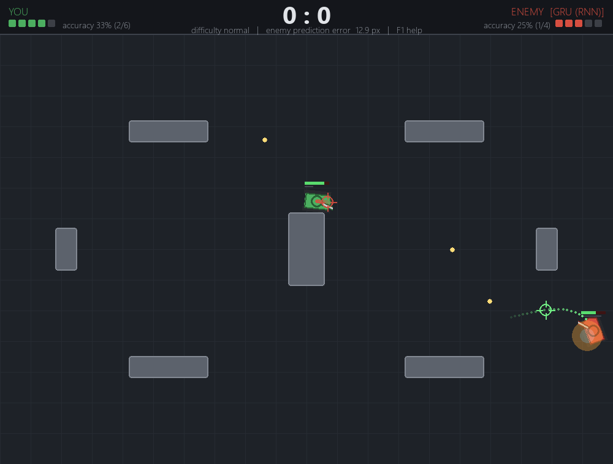

# RNN Tank Arena – predikcia trajektórie pomocou RNN

Projekt do predmetu **MPC-PDA (Pokročilé datové struktury a algoritmy), VUT FEKT**.
Téma: *Tank Game (2D Battle Simulation) – RNN for Trajectory Prediction: predict opponent
movement sequences to aim shots effectively.*

2D tanková hra v Pythone (pygame), v ktorej počítačový tank **predpovedá pohyb súpera
rekurentnou neurónovou sieťou (GRU)** a strieľa tam, kde súper *bude*, nie tam, kde je.
Súčasťou je vlastný fyzikálny simulátor, generátor dát, tréning v PyTorchi (CUDA),
porovnanie s baseline metódami a automatické testy.



## Rýchly štart (Windows)

```bash
# 1. virtuálne prostredie + závislosti (PyTorch s CUDA 12.8)
python -m venv .venv
.venv\Scripts\python -m pip install torch --index-url https://download.pytorch.org/whl/cu128
.venv\Scripts\python -m pip install -r requirements.txt

# 2. hrať (natrénované modely sú v priečinku models/)
.venv\Scripts\python -m tankgame play
```

Alebo stačí dvojklik na **`play.bat`** (hra) / **`watch.bat`** (AI vs AI).

### Ovládanie

| Kláves | Akcia |
|---|---|
| W / S, šípky | dopredu / dozadu |
| A / D, šípky | otáčanie tanku |
| myš | mierenie veže |
| ľavé tlačidlo / medzerník | výstrel |
| 1 – 6 | spôsob mierenia nepriateľa: static, konšt. rýchlosť, konšt. zatáčanie, MLP, LSTM, **GRU** |
| V | zobraziť, čo nepriateľ predpovedá o tebe (bodky + zameriavač) |
| T | asistent mierenia – RNN predikcia pohybu nepriateľa |
| + / − | rýchlosť simulácie, P pauza, R reštart kola, F1 nápoveda, ESC koniec |

## Príkazy

```bash
python -m tankgame play  [--difficulty easy|normal|hard] [--enemy gru|lstm|mlp|ctrv|cv|static] [--record]
python -m tankgame watch [--blue gru] [--red cv] [--speed 4]       # AI vs AI s grafikou
python -m tankgame watch --tournament 50 --blue gru --red cv       # turnaj bez grafiky
python -m tankgame generate --episodes 1600 --seconds 40 --seed 1 --out data/train.npz
python -m tankgame train --model gru --epochs 40
python -m tankgame evaluate                                         # metriky + grafy do docs/
python -m pytest                                                    # testy
```

## Výsledky (testovacie dáta, ktoré model nikdy nevidel)

| Prediktor | ADE (chyba, 1,5 s) | Zásahy na strelnici | Turnaj GRU vs. tento |
|---|---:|---:|---:|
| **GRU (RNN)** | **18,1 px** | **75,0 %** | – |
| LSTM (RNN) | 17,9 px | 74,3 % | 91 : 109 |
| MLP (dopredná NN) | 19,6 px | 70,9 % | 100 : 96 |
| Konštantné zatáčanie | 34,0 px | 56,6 % | 136 : 64 |
| Konštantná rýchlosť | 33,6 px | 55,1 % | 126 : 72 |
| Bez predikcie | 58,4 px | 35,1 % | 184 : 16 |

RNN znižuje chybu predikcie na polovicu a zvyšuje úspešnosť streľby z ~55 % na 75 %.
Detaily: [docs/results.md](docs/results.md), grafy v [docs/img](docs/img).
Kompletná dokumentácia: **[docs/DOKUMENTACIA.md](docs/DOKUMENTACIA.md)**.

## Štruktúra

```
tankgame/      zdrojový kód (simulátor, správanie, dáta, modely, tréning, hra, vyhodnotenie)
tests/         pytest testy
models/        natrénované modely (gru.pt, lstm.pt, mlp.pt) + priebeh tréningu
docs/          dokumentácia, výsledky, grafy, screenshoty
play.bat       spustenie hry, watch.bat – AI vs AI
```
