# RNN Tank Arena – dokumentácia projektu

**Predmet:** MPC-PDA – Pokročilé datové struktury a algoritmy (VUT FEKT)
**Téma:** Tank Game (2D Battle Simulation) → *RNN for Trajectory Prediction – predict opponent
movement sequences to aim shots effectively*
**Autor:** Andrej Pečník (implementácia s pomocou Claude Code)
**Repozitár:** https://github.com/andrejpecnik/rnn_trajectory

---

## Obsah

1. [Zadanie a cieľ](#1-zadanie-a-cieľ)
2. [Čo bolo vytvorené – prehľad](#2-čo-bolo-vytvorené--prehľad)
3. [Inštalácia – čo bolo doinštalované](#3-inštalácia--čo-bolo-doinštalované)
4. [Architektúra programu](#4-architektúra-programu)
5. [Fyzikálny simulátor](#5-fyzikálny-simulátor)
6. [Správanie počítačových tankov](#6-správanie-počítačových-tankov)
7. [Dataset](#7-dataset)
8. [Príznaky a reprezentácia výstupu](#8-príznaky-a-reprezentácia-výstupu)
9. [Modely – RNN a baseline metódy](#9-modely--rnn-a-baseline-metódy)
10. [Tréning](#10-tréning)
11. [Mierenie – od predikcie k výstrelu](#11-mierenie--od-predikcie-k-výstrelu)
12. [Hra](#12-hra)
13. [Vyhodnotenie a výsledky](#13-vyhodnotenie-a-výsledky)
14. [Testovanie](#14-testovanie)
15. [Priebeh práce, problémy a ich riešenia](#15-priebeh-práce-problémy-a-ich-riešenia)
16. [Obmedzenia a možné rozšírenia](#16-obmedzenia-a-možné-rozšírenia)
17. [Referencia príkazov](#17-referencia-príkazov)

---

## 1. Zadanie a cieľ

Zo zoznamu tém cvičenia 01 (*Possible Topics – Tank Game*) bola zvolená podúloha
**RNN for Trajectory Prediction**: predpovedať sekvenciu budúcich pozícií súpera tak, aby
tank vedel mieriť s predstihom. Strela letí konečnou rýchlosťou (420 px/s), takže pri
vzdialenosti 400 px je cieľ zasiahnutý až po ~1 s. Tank, ktorý mieri na *aktuálnu* polohu
súpera, minie každý pohybujúci sa cieľ.

Odporúčanie vyučujúceho bolo nesústrediť sa na „plnú funkčnosť za každú cenu“, ale
**ukázať posun oproti baseline**. Projekt preto obsahuje:

* vlastný 2D simulátor a hrateľnú hru, v ktorej je RNN priamo zabudovaná do AI protivníka,
* dataset trajektórií generovaný v tom istom simulátore,
* RNN modely (GRU, LSTM) a porovnávacie metódy (statický cieľ, konštantná rýchlosť,
  konštantné zatáčanie, dopredná sieť MLP),
* tri nezávislé experimenty, ktoré merajú presnosť predikcie, presnosť streľby a výsledky
  celých zápasov,
* automatické testy celého reťazca.

## 2. Čo bolo vytvorené – prehľad

| Časť | Súbor | Popis |
|---|---|---|
| Konštanty | `tankgame/config.py` | aréna, fyzika, zbrane, dĺžka histórie a horizontu |
| Simulátor | `tankgame/sim.py` | pohyb tankov, kolízie, lúčové senzory, strely |
| Správanie | `tankgame/behaviors.py` | 8 typov jazdy počítačových tankov |
| Dataset | `tankgame/data.py` | generovanie (paralelne), formát `.npz`, okná |
| Príznaky | `tankgame/features.py` | transformácia do „ego“ súradníc tanku, dekódovanie výstupu |
| Modely | `tankgame/models.py` | GRU / LSTM / MLP v PyTorchi |
| Prediktory | `tankgame/predictors.py` | jednotné rozhranie pre siete aj baseline |
| Mierenie | `tankgame/aiming.py` | výpočet bodu stretu strely a cieľa |
| AI | `tankgame/ai.py` | sledovanie súpera, AI ovládač (pohyb + streľba) |
| Herná logika | `tankgame/arena.py` | zápas 1 vs 1, kolá, skóre, turnaj bez grafiky |
| Hra | `tankgame/game.py` | pygame grafika, ovládanie, HUD, nahrávanie hráča |
| Tréning | `tankgame/train.py` | tréning na GPU, ukladanie najlepšieho modelu |
| Vyhodnotenie | `tankgame/evaluate.py` | 3 experimenty, tabuľky, grafy |
| CLI | `tankgame/__main__.py` | `python -m tankgame play / watch / generate / train / evaluate` |
| Testy | `tests/` | pytest – simulátor, dáta, modely, mierenie, hra, tréning |
| Modely | `models/*.pt` | natrénované siete + priebeh tréningu (`*_history.json`, `train_log.txt`) |
| Spúšťače | `play.bat`, `watch.bat` | spustenie dvojklikom vo Windows |

## 3. Inštalácia – čo bolo doinštalované

Všetko je nainštalované **iba v priečinku projektu** vo virtuálnom prostredí `.venv`
(systémový Python ani nič iné na počítači sa nemenilo).

### 3.1 Prostredie

| Položka | Verzia | Poznámka |
|---|---|---|
| OS | Windows 11 Pro | |
| GPU | NVIDIA GeForce RTX 3070 Ti Laptop (8 GB) | ovládač 591.86 (už nainštalovaný) |
| Python | 3.13.14 | už nainštalovaný (Microsoft Store), použitý na vytvorenie `.venv` |
| Git | už nainštalovaný | prístup na GitHub cez SSH kľúč |

### 3.2 Doinštalované balíky (do `.venv`)

| Balík | Verzia | Na čo |
|---|---|---|
| **torch** | 2.11.0+cu128 | neurónové siete; build s **CUDA 12.8** (CUDA runtime a cuDNN sú súčasťou balíka, samostatný CUDA Toolkit netreba) |
| numpy | 2.5.4 | numerika |
| pygame | 2.6.1 (SDL 2.28.4) | grafika a ovládanie hry |
| matplotlib | 3.11.2 | grafy do dokumentácie |
| pytest | 9.2.0 | automatické testy |
| (závislosti) | | filelock, sympy, networkx, jinja2, pillow, contourpy, … – nainštalované automaticky |

### 3.3 Postup inštalácie (zopakovateľný)

```bash
git clone git@github.com:andrejpecnik/rnn_trajectory.git
cd rnn_trajectory
python -m venv .venv
.venv\Scripts\python -m pip install --upgrade pip
.venv\Scripts\python -m pip install torch --index-url https://download.pytorch.org/whl/cu128
.venv\Scripts\python -m pip install -r requirements.txt
```

Overenie, že PyTorch vidí GPU:

```bash
.venv\Scripts\python -c "import torch; print(torch.cuda.is_available(), torch.cuda.get_device_name(0))"
# True NVIDIA GeForce RTX 3070 Ti Laptop GPU
```

Bez GPU všetko funguje tiež (`pip install torch` bez `--index-url`); tréning je len pomalší.
Hra samotná používa sieť na CPU (jedna predikcia trvá ~1 ms).

## 4. Architektúra programu

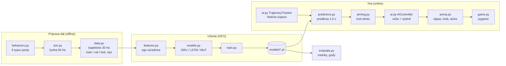

**Tok jedného herného ticku (60 Hz):**

1. `TrajectoryTracker` uloží polohu, natočenie a 3 lúčové vzdialenosti každého tanku
   (každý 2. tick → 30 Hz, teda rovnaká vzorkovacia frekvencia ako v tréningových dátach).
2. Ak pribudla nová vzorka, AI tank zavolá prediktor: z posledných 31 vzoriek (1 s) vypočíta
   45 budúcich pozícií (1,5 s).
3. `aiming.intercept_point` nájde prvý okamih, v ktorom by strela vystrelená teraz dorazila
   k predpovedanej polohe súpera → uhol veže.
4. Veža sa otáča obmedzenou rýchlosťou (4,5 rad/s); keď je odchýlka < 2°, zbraň je nabitá
   a výstrelu nebráni prekážka, AI vystrelí.
5. Simulátor posunie tanky a strely a vyhodnotí zásahy.

## 5. Fyzikálny simulátor

`tankgame/sim.py` je čisto výpočtový (bez grafiky), deterministický a používa sa pri
generovaní dát, vyhodnotení aj v hre. Sieť sa tak učí presne na fyzike, v ktorej potom hrá.

| Parameter | Hodnota |
|---|---|
| Aréna | 1000 × 700 px, 7 obdĺžnikových prekážok |
| Krok fyziky | 1/60 s |
| Tank | kruh r = 18 px, max. 160 px/s dopredu, 100 px/s dozadu |
| Zrýchlenie / brzdenie | 260 / 420 px/s² (zotrvačnosť → pohyb je plynulý, ale nie triviálny) |
| Otáčanie korby / veže | 2,4 rad/s / 4,5 rad/s |
| Strela | 420 px/s, životnosť 3 s, prebíjanie 0,75 s, 5 životov na kolo |

* **Pohyb:** vstupy `throttle ∈ [-1, 1]` a `turn ∈ [-1, 1]`; rýchlosť sa k cieľovej
  hodnote blíži s obmedzeným zrýchlením, poloha sa integruje Eulerovou metódou.
* **Kolízie:** kruh vs. steny a obdĺžniky (najbližší bod obdĺžnika, vytlačenie po normále);
  pri náraze tank stratí polovicu rýchlosti.
* **Lúčové senzory:** vzdialenosť k stene/prekážke v smere 0°, +45°, −45° od natočenia
  (analytický priesečník lúča s obdĺžnikom – „slab“ metóda). Používajú sa ako vstup siete
  (aby vedela, že pred ňou je stena) aj pri vyhýbaní sa prekážkam.
* **Priama viditeľnosť:** test, či úsečka medzi hlavňou a cieľom pretína prekážku.

## 6. Správanie počítačových tankov

Dáta musia obsahovať pohyb, ktorý **jednoduchá extrapolácia nepredpovie, ale sieť
s pamäťou áno** (periodické zatáčanie, náhle cúvanie, zastavovanie). Každé správanie mení
`(throttle, turn)` a navyše sa k nemu pridáva plynulý šum (Ornstein–Uhlenbeckov proces)
a vyhýbanie sa prekážkam pomocou troch lúčov.

| ID | Správanie | Popis |
|---|---|---|
| 1 | `circle` | kruhy s náhodným polomerom, občas zmena smeru |
| 2 | `zigzag` | striedanie ostrej ľavej/pravej zatáčky s periódou 0,5 – 1,6 s |
| 3 | `sine` | plynulé kľučkovanie, zatáčanie podľa sínusoidy |
| 4 | `waypoint` | jazda na náhodné body P-regulátorom |
| 5 | `dodge` | úhyby – náhle prepínanie dopredu/dozadu |
| 6 | `stopgo` | rozjazd, zastavenie (0,3 – 2,5 s), rozjazd iným smerom |
| 8 | `idle` | väčšinou státie, otáčanie na mieste, pomalé posúvanie |
| 7 | `mixed` | každých 2,5 – 7 s prepne na náhodné z vyššie uvedených |

V tréningových dátach je 60 % epizód `mixed` a 40 % jedno pevné správanie.
AI protivníci v hre používajú `mixed` bez `idle` (aby neboli ľahkým terčom).

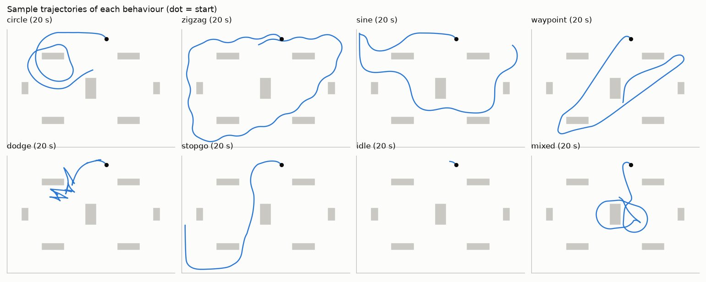

## 7. Dataset

Generovanie: `python -m tankgame generate` – každá epizóda je jeden tank v aréne
s náhodnou počiatočnou polohou, natočením, rýchlosťou a správaním. Epizódy sa generujú
paralelne (multiprocessing, 19 procesov).

| Sada | Epizódy | Dĺžka | Seed | Vzoriek (30 Hz) | Trénovacích okien |
|---|---:|---:|---:|---:|---:|
| train | 1600 | 40 s | 1 | 1 920 000 | 1 800 000 |
| val | 200 | 40 s | 2 | 240 000 | 225 000 |
| test | 200 | 40 s | 3 | 240 000 | 225 000 |

Každá sada je generovaná s iným seedom, takže **testovacie trajektórie sieť nikdy nevidela**.

**Formát** (`.npz`): `traj` (N × 7: x, y, heading, ray_front, ray_left, ray_right,
behavior_id), `offsets` (hranice epizód), `meta` (parametre generovania).
Trénovacie okná sa vyrezávajú až počas tréningu: **31 vzoriek histórie (1 s) + 45 vzoriek
budúcnosti (1,5 s)**, vždy v rámci jednej epizódy. Dáta sa nenahrávajú do Gitu
(`data/` je v `.gitignore`), dajú sa kedykoľvek vygenerovať znova (~10 s).

## 8. Príznaky a reprezentácia výstupu

Kľúčové rozhodnutie: pohyb je vyjadrený v **ego súradniciach** súpera v poslednom
pozorovanom okamihu (os x = smer, ktorým tank práve mieri). Zatáčka doľava tak vyzerá
rovnako v ktorejkoľvek časti arény a sieť sa nemusí učiť každý smer zvlášť.

Vstup pre každý z 30 krokov histórie (11 príznakov):

| # | Príznak | Normovanie |
|---|---|---|
| 0–1 | rýchlosť v ego súradniciach | ÷ 5,33 px (max. posun za krok) |
| 2–3 | cos/sin natočenia voči poslednému natočeniu | – |
| 4–6 | lúčové vzdialenosti (vpredu, vpredu vľavo, vpredu vpravo) | ÷ 300 px |
| 7–8 | absolútna poloha v aréne | na [−1, 1] |
| 9–10 | cos/sin absolútneho natočenia | – |

Absolútna poloha, natočenie a lúče dopĺňajú informáciu o stenách, ktorú ego súradnice
samé neobsahujú. Všetky normovacie konštanty sú pevné (nezávisia od datasetu).

**Výstup:** 45 × 2 posunov za krok v ego súradniciach. Ich kumulatívny súčet sa otočí späť
do súradníc sveta a pripočíta k poslednej polohe (`features.decode`). Vďaka tomu sieť
predpovedá *zmenu* pohybu, nie absolútne čísla, a výstup je hladký.

## 9. Modely – RNN a baseline metódy

### 9.1 GRU / LSTM (hlavný model)

```
vstup (B, 30, 11)
  → GRU/LSTM, 2 vrstvy, 128 skrytých neurónov, dropout 0,1
  → posledný skrytý stav (128) ⊕ posledný vstup (11)
  → Linear 139→256 → ReLU → Linear 256→256 → ReLU → Linear 256→90
  → (B, 45, 2) posuny za krok
```

Rekurentná vrstva zhrnie celú 1-sekundovú históriu (napr. „tank kľučkuje s periódou
0,8 s a práve je v polovici zatáčky“) do skrytého stavu; MLP hlavica z neho naraz vygeneruje
celú budúcu trajektóriu (one-shot dekódovanie, bez kumulácie chýb autoregresie).
Počet parametrov: GRU 277 978, LSTM 329 050 (MLP 478 298).

### 9.2 Porovnávacie metódy

| Metóda | Popis | Učená? |
|---|---|---|
| **Static** | cieľ zostane na mieste (= mierenie priamo na súpera) | nie |
| **Constant velocity (CV)** | rýchlosť z posledných 2 krokov, lineárna extrapolácia | nie |
| **Constant turn rate (CTRV)** | konštantná rýchlosť aj uhlová rýchlosť (klasický model zo sledovania cieľov) | nie |
| **MLP** | dopredná sieť 330→512→512→90 na rovnakých príznakoch, bez rekurencie | áno |

MLP ukazuje, koľko pridáva samotná rekurentná pamäť, a CTRV je silný fyzikálny baseline
(pri jazde po kružnici je presný).

## 10. Tréning

| Nastavenie | Hodnota |
|---|---|
| Strata | Smooth L1 (Huber) na kumulatívnom posune, mierka 50 px |
| Optimalizátor | AdamW, weight decay 1e-4, orezanie gradientu na normu 1,0 |
| Learning rate | OneCycle, max 2e-3, 15 % warm-up |
| Dávka / kroky | 512 okien, 40 epôch × 1000 krokov (20,5 milióna vzoriek) |
| Validácia | 20 000 pevných okien z `val.npz` po každej epoche, ukladá sa najlepší model |
| Hardvér | RTX 3070 Ti, celý dataset je v pamäti GPU, okná sa vyrezávajú priamo na GPU |

Rezanie okien priamo na GPU (indexovanie tenzora) odstraňuje úzke hrdlo DataLoadera,
takže jedna epocha GRU trvá ~6 s.

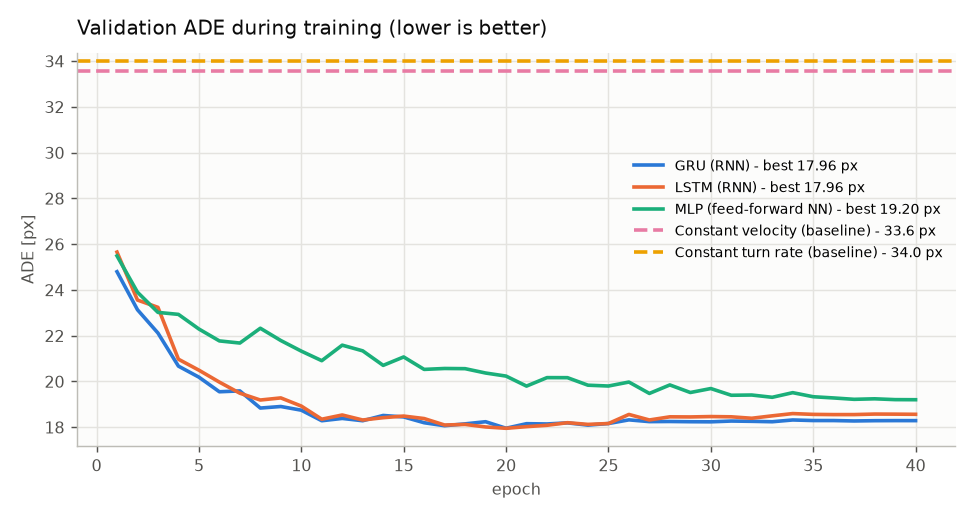

| Model | Parametre | Najlepšia val. ADE | Epocha s najlepšou ADE | Čas tréningu (GPU) |
|---|---:|---:|---:|---:|
| GRU | 277 978 | **17,96 px** | ~20 | 236 s |
| LSTM | 329 050 | 17,96 px | ~20 | 332 s |
| MLP | 478 298 | 19,20 px | ~40 | 107 s |

Rekurentné siete dosiahnu minimum okolo 20. epochy, potom sa validačná chyba mierne
zvyšuje (začiatok preučenia). Ukladá sa preto vždy model s najnižšou validačnou chybou,
nie posledný. GRU a LSTM sú prakticky rovnako presné; **ako hlavný model v hre bola
zvolená GRU**, pretože má menej parametrov a trénuje sa o 30 % rýchlejšie.
Celý výpis tréningu je v `models/train_log.txt`, priebeh po epochách v `models/*_history.json`.

## 11. Mierenie – od predikcie k výstrelu

Strela vystrelená v čase 0 je po čase *t* vo vzdialenosti `L_hlaveň + v_strely · t` od stredu
tanku. Pre predpovedané polohy `p_k` v časoch `t_k = k / 30 s` hľadáme prvé *k*, kde

```
f(k) = |p_k − g| − (L_hlaveň + v_strely · t_k) ≤ 0
```

(g = poloha strieľajúceho tanku). Medzi `k−1` a `k` sa bod stretu lineárne interpoluje.
Ak cieľ nie je dosiahnuteľný ani na konci horizontu (1,5 s), riešenie sa dopočíta
analyticky pre konštantnú rýchlosť (kvadratická rovnica `|p + v·t − g| = L + s·t`).
Uhol veže = smer na bod stretu. Celé je to v `tankgame/aiming.py`.

## 12. Hra

```bash
python -m tankgame play            # alebo dvojklik na play.bat
```

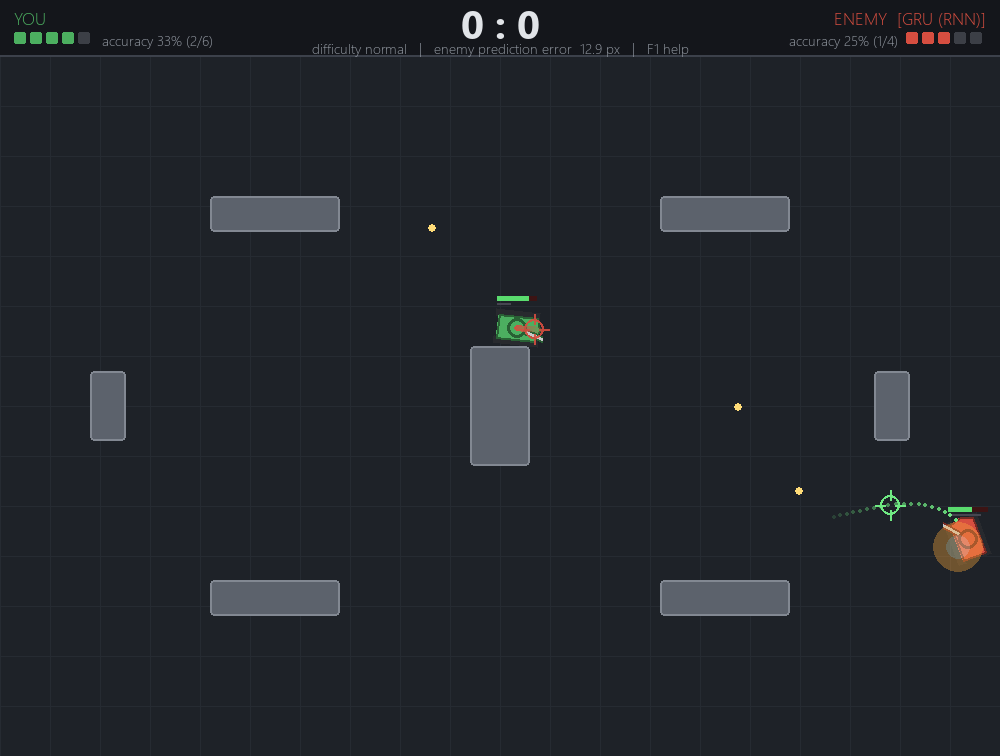

* **Hráč** (zelený) ovláda tank klávesmi WASD, mieri myšou a strieľa ľavým tlačidlom.
* **Nepriateľ** (červený) jazdí podľa správania `mixed` a mieri pomocou zvoleného prediktora
  (predvolene GRU). Kláves **V** zobrazí jeho predikciu tvojho pohybu (bodky) a bod,
  kam mieri (zameriavač). Klávesmi **1–6** sa dá za behu prepínať, ako nepriateľ mieri,
  a hneď vidieť rozdiel.
* **HUD:** životy, skóre, presnosť streľby a **živá chyba predikcie** – priemerná
  vzdialenosť medzi tým, čo nepriateľ pred 1,5 s predpovedal, a tým, kam si naozaj prišiel.
* **Asistent mierenia (T):** RNN predikuje pohyb nepriateľa a ukáže, kam mieriť.
* **Obtiažnosť** (`--difficulty`): `easy` (prebíjanie 1,4 s, náhodná chyba mierenia 4°),
  `normal` (1,0 s, 1,7°), `hard` (0,75 s, bez chyby – čistý výkon RNN).
* **Nahrávanie** (`--record`): tvoje trajektórie sa uložia do `data/recorded/` a dajú sa
  pridať do tréningu (`train --extra data/recorded/*.npz`), aby sa sieť prispôsobila
  ľudskému štýlu jazdy.
* **Režim watch:** dva AI tanky, každý mieri iným prediktorom (predvolene modrý GRU vs.
  červený CV). `--speed` zrýchli simuláciu, `--tournament N` odohrá N kôl bez grafiky.

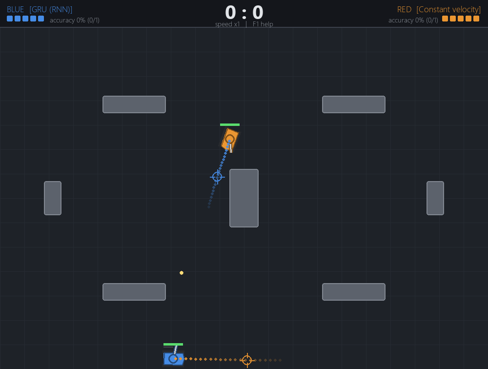

## 13. Vyhodnotenie a výsledky

Všetko sa dá zopakovať príkazom `python -m tankgame evaluate --rounds 200` (~2,5 min).
Číselné výsledky sú v `docs/results.json` a `docs/results.md`, výpis v
`docs/evaluate_log.txt`. Všetky experimenty bežia na dátach, ktoré pri tréningu neboli
použité (testovacia sada seed 3, strelnica seed 10 000+, turnaje seed 100+).

### 13.1 Experiment 1 – presnosť predikcie

30 000 náhodných okien z testovacej sady. Metriky:
**ADE** (*Average Displacement Error*) = priemerná vzdialenosť predikcie od skutočnosti
cez všetkých 45 krokov; **FDE** (*Final Displacement Error*) = chyba v poslednom kroku (1,5 s).

| Prediktor | ADE [px] | Chyba v 1 s [px] | FDE 1,5 s [px] | Zlepšenie ADE oproti CV |
|---|---:|---:|---:|---:|
| **GRU (RNN)** | **18,1** | **24,7** | **44,7** | **−46 %** |
| LSTM (RNN) | 17,9 | 24,5 | 44,3 | −47 % |
| MLP (dopredná NN) | 19,6 | 26,8 | 47,2 | −42 % |
| Konštantné zatáčanie (CTRV) | 34,0 | 45,9 | 87,3 | +1 % |
| Konštantná rýchlosť (CV) | 33,6 | 46,0 | 77,7 | – |
| Static (bez predikcie) | 58,4 | 76,4 | 108,6 | +74 % |

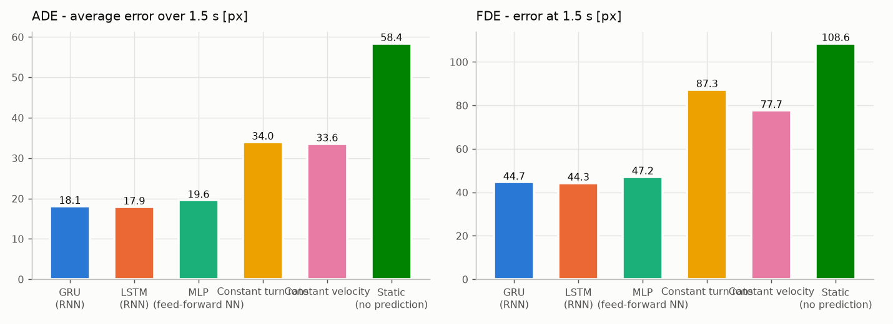

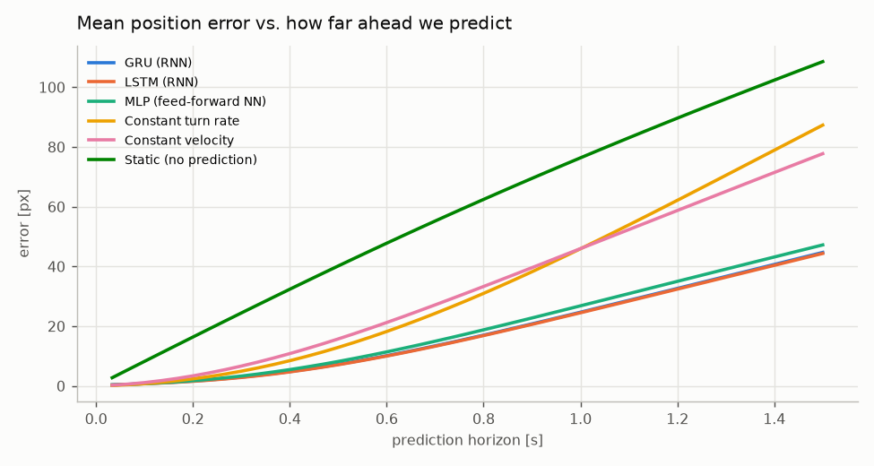

Do ~0,2 s sú všetky metódy podobné (pohyb je krátkodobo takmer priamočiary). S rastúcim
horizontom fyzikálne modely rýchlo strácajú presnosť, lebo nepoznajú *zámer* súpera;
rekurentné siete majú pri 1,5 s polovičnú chybu.

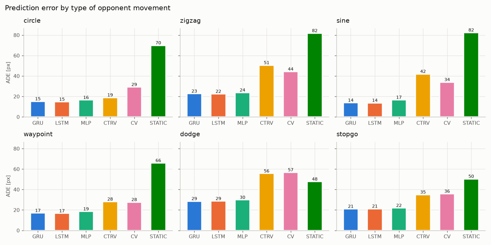

Najväčší rozdiel je pri **sínusovom kľučkovaní** (14 px vs. 34 px CV) a **zigzagu**
(23 px vs. 44 px) – presne tam, kde je potrebná pamäť: sieť z histórie rozpozná periódu
a fázu zatáčania a predpovie ďalší obrat. CTRV je dobrý len pri jazde po kružnici
(19 px), pri striedavom zatáčaní je dokonca horší než CV, lebo extrapoluje aktuálnu
zatáčku do nekonečna. Pri **úhyboch** (`dodge`) sú CV aj CTRV (56 – 57 px) dokonca horšie
ako „žiadna predikcia“ (48 px): po náhlom prepnutí dopredu/dozadu extrapolácia posiela
predikciu nesprávnym smerom. GRU má aj tu najnižšiu chybu (29 px).

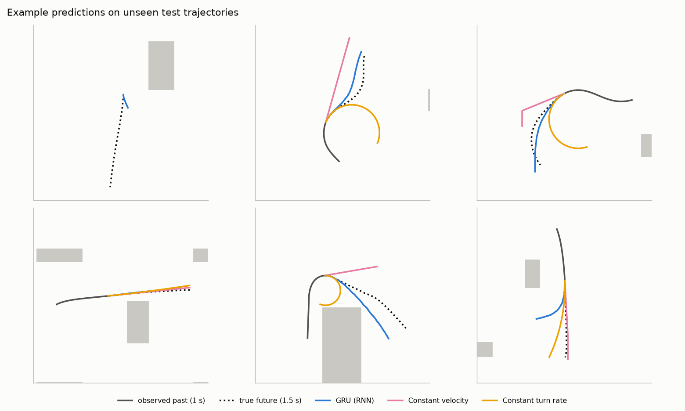

Ukážky na testovacích dátach: modrá = GRU, ružová = konštantná rýchlosť, oranžová =
konštantné zatáčanie, bodkovaná čierna = skutočnosť. Prvý panel je zámerne aj príklad
chyby – tank stál na mieste a v okne predikcie sa rozbehol; z histórie sa to predpovedať
nedá.

### 13.2 Experiment 2 – strelnica (presnosť streľby)

400 scenárov: cieľ jazdí náhodným správaním 12 s, strieľajúci tank stojí 300–600 px
od neho a každých 0,75 s vystrelí. **Trajektórie cieľa sú pre všetky prediktory úplne
rovnaké**, líši sa len mierenie – rozdiel v počte zásahov je teda čisto zásluhou predikcie.
Spolu 4 400 výstrelov na prediktor (štatistická neistota ±0,7 p. b.).

| Prediktor | Zásahy |
|---|---:|
| **GRU (RNN)** | **75,0 %** |
| LSTM (RNN) | 74,3 % |
| MLP (dopredná NN) | 70,9 % |
| Konštantné zatáčanie | 56,6 % |
| Konštantná rýchlosť | 55,1 % |
| Static (mierenie priamo na cieľ) | 35,1 % |

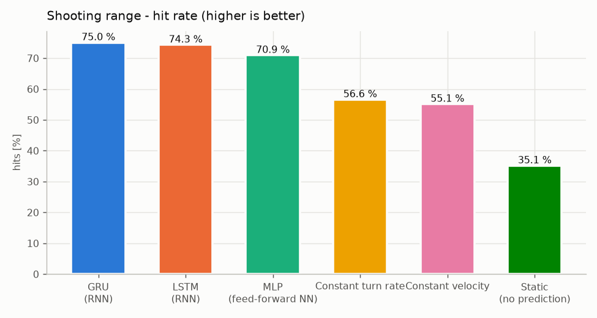

**GRU trafí o 18 – 20 percentuálnych bodov viac ako fyzikálne metódy (+32 % relatívne
oproti najlepšej z nich) a viac než dvojnásobok oproti miereniu priamo na cieľ.** Rekurentná sieť je
signifikantne lepšia aj ako MLP s rovnakými vstupmi (+4 p. b.), teda pamäť RNN reálne
pomáha.

### 13.3 Experiment 3 – turnaje (celé zápasy)

Dva AI tanky s rovnakým správaním (`mixed` bez `idle`), rovnakou fyzikou, prebíjaním aj
pohybom; **jediný rozdiel je prediktor použitý na mierenie**. 200 kôl na dvojicu, 5 životov
na kolo, prekážky blokujú strely.

| GRU tank vs. | Výhry GRU | Výhry súpera | Remízy | Presnosť GRU | Presnosť súpera |
|---|---:|---:|---:|---:|---:|
| Static | **184** | 16 | 0 | 66,5 % | 28,0 % |
| Konštantná rýchlosť | **126** | 72 | 2 | 66,5 % | 52,6 % |
| Konštantné zatáčanie | **136** | 64 | 0 | 67,2 % | 50,6 % |
| MLP | 100 | 96 | 4 | 65,4 % | 64,2 % |
| LSTM | 91 | 109 | 0 | 63,5 % | 66,1 % |

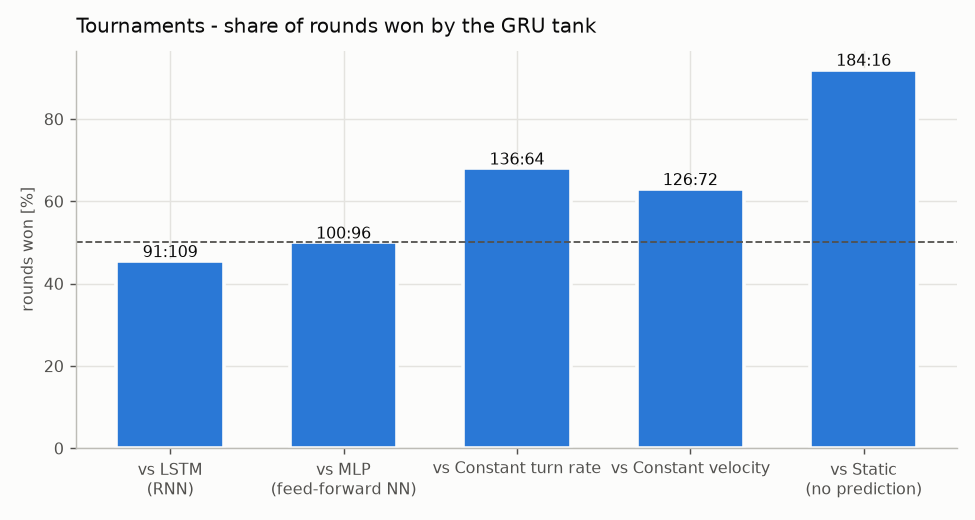

GRU vyhráva **68 % kôl proti CTRV, 63 % proti CV a 92 % proti miereniu priamo na cieľ**.
Proti MLP a LSTM je výsledok vyrovnaný: rozdiel 91:109 je v rámci štatistického šumu
(smerodajná odchýlka pri 200 kolách je ±7 kôl), čo zodpovedá takmer rovnakej presnosti
predikcie v experimente 1. (Pri prvom behu so 60 kolami vyšlo GRU vs. LSTM 34:26 –
ukážka, prečo bolo potrebné zvýšiť počet kôl.)

### 13.4 Zhrnutie

* RNN predikcia trajektórie **znižuje chybu predikcie na polovicu** oproti klasickým
  fyzikálnym modelom (ADE 18 px vs. 34 px).
* V streľbe to znamená **75 % zásahov namiesto 55 – 57 %** a v celých zápasoch výhru
  v 63 – 68 % kôl proti tankom s fyzikálnou predikciou.
* Najväčší prínos je pri pohybe s opakujúcim sa vzorom (kľučkovanie, zigzag, úhyby),
  ktorý si sieť „zapamätá“ z poslednej sekundy.
* GRU ≈ LSTM; dopredná sieť (MLP) je o niečo slabšia, ale stále výrazne lepšia ako
  fyzikálne modely – veľkú časť zisku prináša samotné učenie z dát a ego reprezentácia,
  rekurencia pridáva ďalších ~8 % presnosti.

## 14. Testovanie

```bash
.venv\Scripts\python -m pytest
```

**Výsledok: 50 testov, 50 prešlo (≈13 s).** Kompletný výpis je v `docs/test_report.txt`.
Testy hry bežia bez okna (SDL „dummy“ ovládač), takže sa dajú spúšťať aj automaticky.

| Súbor | Čo overuje |
|---|---|
| `test_sim.py` (12) | zrýchlenie na max. rýchlosť, cúvanie, rýchlosť otáčania, steny, vytláčanie z prekážok, lúčové senzory, priama viditeľnosť, streľba a prebíjanie, životnosť strely, obmedzená rýchlosť veže, voľné pozície |
| `test_behaviors_data.py` (12) | každé z 8 správaní sa hýbe (idle stojí) a nikdy nevojde do prekážky ani neprekročí max. rýchlosť; determinizmus generovania; formát datasetu; okná nepresahujú hranice epizód; nahrávky hráča a spájanie datasetov |
| `test_models_predictors.py` (16) | tvar a ego transformácia príznakov; `decode` je presná inverzia `ego_targets`; dopredný prechod GRU/LSTM/MLP; CV je presný na priamke, CTRV na kružnici; orezanie na arénu; fallback pri krátkej histórii; **natrénovaná GRU** sa načíta, predpovedá rozumne na priamke, **stojaci tank nechá stáť** a na čerstvo vygenerovaných dátach má **o >15 % nižšiu chybu ako CV aj CTRV**; výpočet bodu stretu a simulácia, že presne mierená strela pohybujúci sa cieľ naozaj trafí |
| `test_game.py` (9) | sledovanie súpera 30 Hz a meranie chyby predikcie; AI trafí stojaci cieľ; priebeh kola (výhra, pauza, reset); turnaj bez grafiky; **pygame front-end v režimoch play aj watch** (420 snímok, screenshot, nápoveda, asistent); vstup hráča (pohyb + streľba); uloženie nahrávky; CLI |
| `test_training.py` (1) | mini tréning na malých dátach: validačná chyba sa nezhorší, uloží sa checkpoint aj história a dá sa načítať ako prediktor |

Okrem automatických testov bola hra overená aj ručne: spustenie v skutočnom okne,
screenshoty všetkých režimov (`docs/img/screenshot_*.png`) a kontrola, že 900 snímok
s RNN trvá ~5 s (hra beží výrazne nad 60 FPS).

## 15. Priebeh práce, problémy a ich riešenia

### 15.1 Postup

1. **Štúdium podkladov** – prednášky (RNN/LSTM/GRU – `10_pr_rnn`), cvičenie s predikciou
   časových radov (`10_cv`: diferencie, škálovanie, LSTM, RMSE) a úvodné cvičenie
   so zoznamom tém (`01_cv_intro`). Z cvičenia bol prevzatý princíp **učiť sa rozdiely
   (posuny), nie absolútne hodnoty**, a pevné škálovanie.
2. **Príprava prostredia** – klon repozitára do priečinka `Projekt`, vetva
   `feature/rnn-tank-game`, virtuálne prostredie, PyTorch s CUDA 12.8, overenie GPU.
3. **Simulátor a správanie** – fyzika, kolízie, lúče; vizuálna kontrola trajektórií
   všetkých správaní (či sa tanky nezasekávajú pri stenách).
4. **Dataset a tréning** – rýchly sanity tréning (300 krokov: GRU 27 px vs. CV 39 px) na
   overenie, že reťazec funguje, potom plný tréning GRU, LSTM, MLP.
5. **Hra** – herná logika oddelená od grafiky (`arena.py` vs. `game.py`), aby sa dala
   testovať a spúšťať bez okna; potom pygame front-end, HUD a nastavenia.
6. **Testy** – 50 automatických testov.
7. **Vyhodnotenie** – tri experimenty a grafy, dokumentácia.

### 15.2 Problémy, na ktoré sa prišlo počas testovania, a ich riešenia

| Problém | Ako sa prejavil | Riešenie |
|---|---|---|
| **Sieť nepoznala stojaci tank** | Test „AI trafí stojaci cieľ“ zlyhal (1 zásah z 20 s). Analýza ukázala, že pre tank, ktorý 1 s stojí, GRU predpovedala rozjazd o 100+ px – v dátach žiadny tank nestál dlhšie ako 1 s, takže „státie“ vždy znamenalo „o chvíľu sa rozbehne“. | Nové správanie `idle` (státie, otáčanie na mieste, pomalé posúvanie) a dlhšie zastavenia v `stopgo` (až 2,5 s), nové dáta, pretrénovanie. Pribudol test, že predikcia stojaceho tanku zostane do 15 px. Pre hru s človekom je to podstatné – hráči často zastavia, aby zamierili. |
| **Nepresný baseline CTRV** | Test „CTRV je presný na kružnici“ ukázal chybu 2,6 px namiesto ~0. | Smer tetivy medzi vzorkami t−2 a t zodpovedá dotyčnici v čase t−1, nie v čase t; uhol k-teho kroku je preto `θ + ω·(k + 0,5)`. Po oprave je CTRV na kružnici presný, takže porovnanie s RNN je férové. |
| **Príliš presný nepriateľ** | V režime watch padlo kolo za 7 s (5 zásahov z 5). Pre človeka by bol GRU nepriateľ nehrateľný. | Nastavenie obtiažnosti pre ľudského hráča (prebíjanie + malá náhodná chyba mierenia). V experimentoch a turnajoch sa handicap nepoužíva. |
| **Štatistický šum v turnajoch** | Pri 60 kolách vyšlo GRU vs. LSTM 34:26, hoci obe siete majú rovnakú presnosť. | Turnaje zvýšené na 200 kôl na dvojicu; hlavné tvrdenia sa opierajú o strelnicu (4 400 výstrelov s rovnakými trajektóriami pre všetky prediktory). |
| **Idle správanie v hre** | Ak by AI protivník používal aj `idle`, občas by len stál. | `MixedBehavior` dostal parameter `pool`; hra a turnaje používajú `GAME_BEHAVIORS` (bez `idle`), dáta všetky správania. |

### 15.3 Git a GitHub

* Práca prebiehala vo vetve `feature/rnn-tank-game` v repozitári
  `andrejpecnik/rnn_trajectory`; vetva `main` zostala nedotknutá.
* Do repozitára patria zdrojové kódy, testy, natrénované modely (`models/*.pt`, spolu
  ~4 MB), dokumentácia a grafy. Virtuálne prostredie (`.venv/`) a dáta (`data/`) sú
  v `.gitignore` – dajú sa znovu vytvoriť príkazmi zo sekcie 3 a 17.

## 16. Obmedzenia a možné rozšírenia

* **Ľudský hráč ≠ boti.** Sieť je natrénovaná na trajektóriách počítačových tankov. Ľudský
  štýl jazdy je iný; riešením je `--record` a dotrénovanie na nahrávkach hráča.
* **Súper nereaguje na strely.** Správanie botov nezohľadňuje letiace strely; skutočne
  adaptívny súper (napr. RL agent, ktorý sa učí uhýbať) by bol ťažší cieľ a prirodzené
  pokračovanie projektu (podtéma *RL Tank Agent*).
* **Jedna mapa.** Aréna je pevná. Pri náhodných mapách by sieť potrebovala bohatší popis
  okolia (viac lúčov alebo CNN nad mapou – podtéma *CNN-based Vision*).
* **Bodová predikcia.** Model predpovedá jednu najpravdepodobnejšiu trajektóriu. Pri
  nejednoznačných situáciách (cieľ sa môže otočiť doľava aj doprava) by pomohla
  pravdepodobnostná predikcia (zmes Gaussiánov) a mierenie do oblasti s najvyššou
  pravdepodobnosťou zásahu.

## 17. Referencia príkazov

| Príkaz | Popis |
|---|---|
| `python -m tankgame play [--difficulty easy\|normal\|hard] [--enemy gru] [--record]` | hra proti AI |
| `python -m tankgame play --autopilot` | demo: aj tvoj tank riadi AI |
| `python -m tankgame watch [--blue gru] [--red cv] [--speed 4]` | AI vs AI s grafikou |
| `python -m tankgame watch --tournament 50 --blue gru --red ctrv` | turnaj bez grafiky |
| `python -m tankgame generate --episodes 1600 --seconds 40 --seed 1 --out data/train.npz` | generovanie dát |
| `python -m tankgame train --model gru\|lstm\|mlp [--epochs 40] [--extra data/recorded/*.npz]` | tréning |
| `python -m tankgame evaluate` | všetky experimenty + grafy do `docs/` |
| `python -m pytest` | testy |

Kompletné zopakovanie projektu od nuly:

```bash
python -m tankgame generate --episodes 1600 --seconds 40 --seed 1 --out data/train.npz
python -m tankgame generate --episodes 200  --seconds 40 --seed 2 --out data/val.npz
python -m tankgame generate --episodes 200  --seconds 40 --seed 3 --out data/test.npz
python -m tankgame train --model gru
python -m tankgame train --model lstm
python -m tankgame train --model mlp
python -m tankgame evaluate
python -m pytest
```
